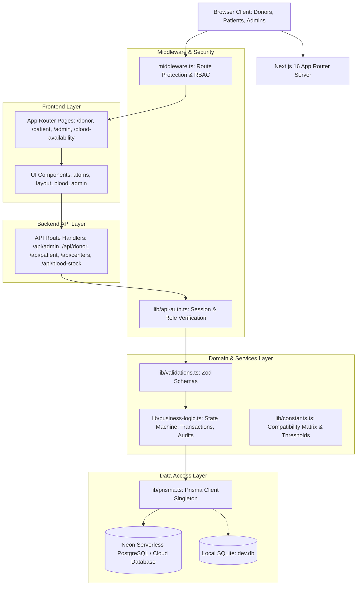

# LifePulse BMS — System Architecture Documentation

## 1. Overview & Architectural Principles

LifePulse is an enterprise-ready, full-stack blood bank and donation management system built on **Next.js 16 (App Router)**, **TypeScript**, **Prisma ORM**, and **Tailwind CSS v4**.

The application unifies three primary stakeholders into a single, cohesive ecosystem:
- **Donors**: Manage availability, view eligibility and donation statistics, schedule donations, and monitor verification status.
- **Patients & Healthcare Facilities**: Search real-time multi-center blood inventory, locate nearby centers, and submit urgent/emergency blood requests.
- **Administrators**: Supervise multi-center inventories, verify donations, approve/fulfill blood requests, manage blood centers and stock levels, and inspect comprehensive audit logs.



---

## 2. Directory Structure & Layer Mapping

```text
blood-management-system/
├── app/                             # Frontend Routes & Backend API Handlers
│   ├── (public)/                    # Public Landing, About, Contact, Availability
│   ├── admin/                       # Protected Admin Dashboard & Management Pages
│   ├── donor/                       # Protected Donor Portal Pages
│   ├── patient/                     # Protected Patient/Hospital Portal Pages
│   ├── centers/[id]/                # Dynamic Blood Center Detail Pages
│   ├── api/                         # Backend REST API Controllers (HTTP Layer)
│   │   ├── admin/                   # Admin endpoints (stock, donations, requests, reports)
│   │   ├── auth/                    # NextAuth & registration endpoints
│   │   ├── blood-stock/             # Public aggregated stock endpoint
│   │   ├── centers/                 # Multi-center search, detail, and stock endpoints
│   │   ├── donor/                   # Donor availability, donations, profile endpoints
│   │   ├── notifications/           # User notification endpoints
│   │   └── patient/                 # Patient profile and request endpoints
│   ├── layout.tsx                   # Global Root Layout (Providers, Navbar, Footer)
│   └── globals.css                  # Tailwind CSS v4 Theme & Custom Scrollbars
│
├── components/                      # Frontend Component Hierarchy
│   ├── ui/                          # Atoms: Button, Badge, Card, Modal, Toast, States
│   ├── layout/                      # Structural: Navbar, Footer
│   ├── blood/                       # Domain: BloodFinder, CenterDetailClient, PatientBloodFinder
│   ├── admin/                       # Domain: CentersAdminPanel, Charts
│   ├── providers/                   # Context: Providers (NextAuth SessionProvider)
│   ├── BloodFinder.tsx              # Backward-compatibility re-export bridge
│   └── Providers.tsx                # Backward-compatibility re-export bridge
│
├── lib/                             # Core Domain, Services, & Shared Modules
│   ├── business-logic.ts            # Domain Service: Transactions, Verification, Fulfillments
│   ├── auth.ts                      # NextAuth Configuration & Credentials Provider
│   ├── api-auth.ts                  # Backend Route Guards: requireAuth, requireRole
│   ├── validations.ts               # Zod Input Validation Schemas
│   ├── constants.ts                 # Stock Thresholds, Blood Group Enums & Display Maps
│   └── prisma.ts                    # Prisma Client Singleton
│
├── prisma/                          # Database Definition & Seeding
│   ├── schema.prisma                # Definitive Prisma Schema (PostgreSQL / SQLite)
│   ├── seed.ts                      # Multi-role Demo Seed with 5 Centers & 40 Stock Records
│   └── dev.db                       # Local SQLite Database (fallback)
│
├── tests/                           # Automated Test Suites
│   └── unit/                        # Business Logic & State Machine Unit Tests
│
├── scripts/                         # Operational & Verification Tooling
│   ├── e2e-verify.ts                # Full 14-Step End-to-End Simulation Script
│   ├── verify-finder-features.ts    # Multi-Center Search & Privacy Verification Script
│   └── switch-db.ts                 # Schema Datasource Provider Switcher (Postgres / SQLite)
│
├── docs/                            # Comprehensive Documentation
│   ├── ARCHITECTURE.md              # System Architecture & Technical Specifications
│   ├── API_REFERENCE.md             # REST API Endpoint Documentation
│   └── DEPLOYMENT.md                # Production Deployment Guide (Vercel & Neon)
│
├── middleware.ts                    # Edge Routing & RBAC Authorization Middleware
├── next.config.ts                   # Next.js Runtime Configuration
├── tsconfig.json                    # TypeScript Configuration & Path Aliases
└── vitest.config.ts                 # Vitest Test Runner Configuration
```

---

## 3. Role-Based Access Control (RBAC) & Security

The system enforces authentication and authorization at two independent boundaries:

### Boundary 1: Edge Routing Middleware (`middleware.ts`)
Inspects inbound requests to `/admin/:path*`, `/donor/:path*`, and `/patient/:path*`:
1. Validates the JWT session signed with `NEXTAUTH_SECRET`.
2. Unauthenticated requests are redirected to `/login?callbackUrl=<target>`.
3. Users attempting to access a route belonging to another role are redirected to `/403` (Forbidden).

### Boundary 2: API Route Guards (`lib/api-auth.ts`)
Each API handler verifies user identity and authorization before executing business logic:
- `requireAuth()`: Ensures session presence.
- `requireRole(["ADMIN"])`: Restricts administrative routes to admin accounts.
- `requireRole(["DONOR"])`: Restricts donor-specific actions to donors.
- `requireRole(["PATIENT"])`: Restricts patient-specific actions to patients.

---

## 4. State Machine & Inventory Transactions

The core transactional logic is implemented in `lib/business-logic.ts` using Prisma interactive transactions (`client.$transaction`):

### Donation Verification State Machine
```text
[Donor Submits Record] ──> Status: PENDING
                                │
               ┌────────────────┴────────────────┐
               ▼                                 ▼
      [Admin Verifies]                  [Admin Rejects]
               │                                 │
     Status: VERIFIED                  Status: REJECTED
  Stock Incremented (+N units)         Stock Unchanged
  Audit Log Recorded                   Audit Log Recorded
  Donor Notification Sent              Donor Notification Sent
```

### Blood Request Approval & Fulfillment State Machine
```text
[Patient Submits Request] ──> Status: PENDING
                                    │
                   ┌────────────────┴────────────────┐
                   ▼                                 ▼
          [Admin Approves]                  [Admin Rejects]
                   │                                 │
          Status: APPROVED                  Status: REJECTED
          Stock Unchanged                   Stock Unchanged
          Patient Notified                  Patient Notified
                   │
                   ▼
          [Admin Fulfills]
                   │
          Status: FULFILLED
       Stock Decremented (-N units)
       Race-Condition Checked (ConflictError if units > stock)
       Patient Notification Sent
       Audit Log Recorded
```

### Race Condition & Double-Deduction Safeguards
1. **Interactive Database Transactions**: Inventory deduction and status transitions occur in an atomic transaction block.
2. **Status Pre-Condition Checks**: If an admin attempts to fulfill a request that has already been fulfilled or cancelled, a `ConflictError` is thrown immediately.
3. **Stock Underflow Prevention**: If required units exceed available stock at fulfillment time, the transaction rolls back cleanly with a descriptive error.
